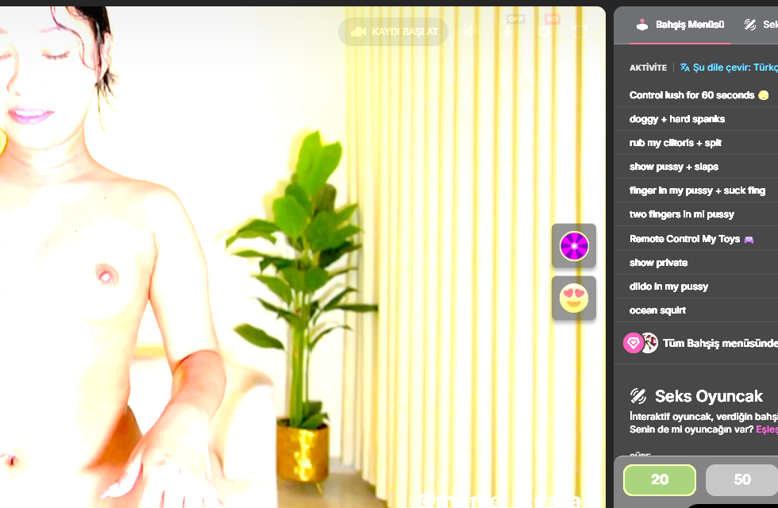
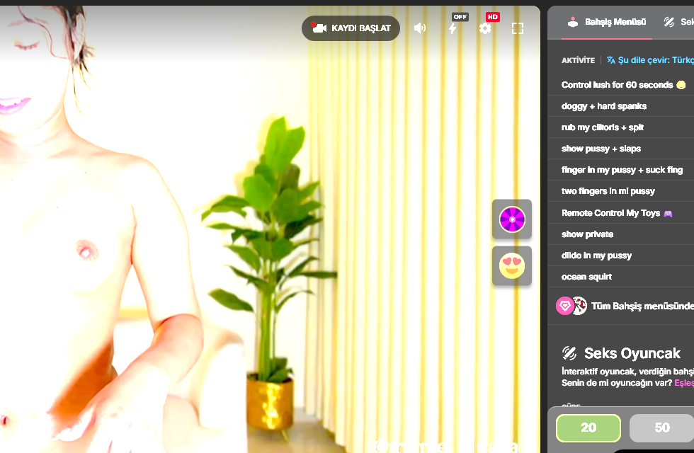

# Klavye Testi Merkezi

  

Türkçe **Q** klavyesindeki (KBDTUQ) tuşların tamamını tek tek sınayan, Windows
üzerinde çalışan küçük bir masaüstü uygulaması. Tuşlar klavyedeki **fiziksel
sırayla** sorulur; alfabetik sıra kullanılmaz.

## Özellikler

- **104 adımlı test:** Fonksiyon tuşlarından sayısal takıma kadar tüm tuşlar.
- **Görsel klavye haritası:** Şu an basılması gereken tuş turkuaz, geçen tuşlar
  yeşil, kaçırılan tuşlar kırmızı yanar.
- **Doğru algılama:** `GetAsyncKeyState` ile yüksek bit kenar algılama; düşük bit
  yalnızca yedek olarak kullanılır. Tuşlar tarayıcıda kaçırıldığı için tarayıcı
  yerine masaüstü uygulaması tercih edilmiştir.
- **Kilit tuşları:** CapsLock, NumLock ve ScrollLock için LED'e değil,
  `TOGGLE` kaydına bakılır.
- **İpucu penceresi:** Test sırasında yalnızca "*BAS: ...*" yazan küçük pencere
  görünür; ana pencereyi kapatmaz.
- **Ayarlar:** Süreler, algılama hızı, ipucu penceresinin konumu ve boyutu,
  sonuç dosyası yolu, koyu tema, sesli geri bildirim ve isteğe bağlı tuşlar.
- **Sonuç:** Tablo, olay kaydı ve masaüstündeki `klavye-testi-sonucu.txt`
  dosyası. Sonuç ayrıca "*Farklı kaydet*" ile başka bir yere yazılabilir.
- **Güvenli davranış:** Test sürerken ayarlar kilitlenir; iptal (`Ctrl + Shift +
  Q`) ve durdurma anında etkili olur.

## Başlatma

| Yöntem | Açıklama |
| --- | --- |
| **`Klavye Testi.exe`** | Önerilen. Çift tıkla; konsol penceresi görünmez. İmzasız olduğu için Windows ilk açılışta "*Daha fazla bilgi → Yine de çalıştır*" diyebilir. |
| **Masaüstü kısayolu** | `Klavye Testi.lnk`, uygulamayı gizli VBS başlatıcısıyla açar. |
| **`klavye-testi.vbs`** | Klasör içinden çift tıkla; yine konsolsuz açılır. |
| **`klavye-testi.ps1`** | Kaynak çalıştırma: `powershell -ExecutionPolicy Bypass -File klavye-testi.ps1`. |

EXE, içine gömülü betik sayesinde tek başına çalışır; `.ps1` dosyasına ihtiyaç
duymaz. Diğer yöntemlerde Windows'un yerleşik PowerShell 5.1 veya üzeri gerekir;
ek paket kurulumu yoktur.

## Kullanım

1. Uygulamayı aç ve **▶ Başlat** düğmesine bas (veya `Test > Başlat`).
2. İpucu penceresinde yazan tuşa bas. Sıra klavyedeki fiziksel sıradadır.
3. Kilit tuşlarında LED'e değil, ekrandaki `TOGGLE` değerine bak.
4. Testi yarıda kesmek için `Ctrl + Shift + Q` kullan veya **■ Durdur**'a bas.

Sonuçlar `Sonuçlar` sekmesinde, renkli durumlar `Klavye` sekmesinde, ayrıntılı
satırlar `Olay Kaydı` sekmesinde görünür.

## Hakkında bilinmesi gerekenler

- **Fn tuşu Windows'a bildirilmediği için sınanamaz.** `Sağ Win (varsa; Fn
  değil)` seçeneği yalnızca gerçek bir Sağ Win tuşu bulunan klavyeler içindir;
  Fn tuşunun yerine geçmez.
- Numpad `Enter`, ana `Enter` ile aynı VK kodunu gönderdiği için ayrıca sınanmaz.
- NumLock kapalıyken numpad gezinme kodları da (`Home`, `End` ve benzeri) geçerli
  sayılır.
- Sesli geri bildirim **varsayılan olarak kapalıdır**; test sırasında Windows
  uyarı sesi duyulmaz. Ayarlar'dan açılabilir.
- Sonuç dosyası varsayılan olarak masaüstündeki `Klavye Testi` klasöründedir.
  Ayarlarda göreli bir yol yazarsan bu klasöre göre çözümlenir; boş bırakırsan
  varsayılan kullanılır.

## Dosyalar

| Dosya | İşlev |
| --- | --- |
| `Klavye Testi.exe` | Tek tıkla çalışan sürüm |
| `klavye-testi.ps1` | Asıl uygulama |
| `klavye-testi.vbs` | Konsolsuz başlatıcı |
| `klavye-testi.ico` | Uygulama simgesi |
| `klavye-testi-ayarlar.json` | Kaydedilen ayarlar (ilk kayıtta oluşur) |
| `klavye-testi-sonucu.txt` | Son testin sonucu |
| `CHANGELOG.md` | Sürüm geçmişi |

Kaynak tuş eşlemesi: [kbdlayout.info/KBDTUQ](https://kbdlayout.info/KBDTUQ) ve
Microsoft `GetAsyncKeyState` belgeleri.

**Made by jaNNberk** · With help of Opencode and Copilot ;)
